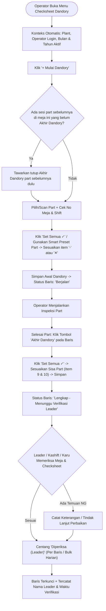

# PRD & Rancangan Arsitektur: Menu Checksheet Dandory Quality

---

## 1. Dokumen Kontrol & Ringkasan

| Parameter | Keterangan |
| :--- | :--- |
| **Nama Fitur / Menu** | Checksheet Dandory Quality |
| **Acuan Dokumen ISO** | `QC-KRW-F-0094` (Plant Karawang) / `QC-JKT-F-0094` (Plant Jakarta) — Tgl. Terbit: `17/10/2025` |
| **Referensi File Fisik** | `094. Checksheet Dandory Quality.xlsx` (Sheet: `Quality`) |
| **Referensi Pola UI** | `resources/views/operator_compliance/index.blade.php` & `resources/views/in_process/index.blade.php` |
| **Lokasi Menu Sidebar** | Plant Karawang -> Checksheet -> `Dandory Quality`<br>Plant Jakarta -> Checksheet -> `Dandory Quality` |
| **Target Pengguna** | Operator / Inspector QC, Leader (Kashift / Karu QC), Supervisor, Asst. Manager, Manager, Admin |
| **Status Dokumen** | **Disetujui (Approved by User)** |

---

## 2. Latar Belakang & Karakteristik Proses Dandory

Pada lantai inspeksi QC, aktivitas **Dandory** (persiapan awal dan perapihan akhir saat berganti part di meja inspeksi) memiliki pola kerja yang sedikit berbeda dari *Checksheet Kepatuhan Operator*:

1. **Frekuensi Transaksi per Hari Lebih Tinggi**:
   - Pada *Kepatuhan Operator*, 1 operator diaudit berdasarkan kolom tanggal `1 s/d 31` (1 kolom per jadwal).
   - Pada *Checksheet Dandory Quality*, **1 baris data mewakili 1 sesi pemeriksaan part (pergantian part)**. Dalam 1 hari dan 1 shift, seorang operator di meja yang sama bisa memeriksa beberapa part berbeda secara berurutan.
2. **Pengisian Terbagi dalam 2 Waktu (2 Fase)**:
   - **Awal Dandory (9 Item)**: Diisi saat operator **mulai** menyiapkan meja sebelum memeriksa part baru.
   - **Akhir Dandory (10 Item)**: Diisi saat operator **selesai** memeriksa part tersebut sebelum beralih ke part berikutnya atau saat akhir shift.
3. **Tata Letak Cetak Khas (Split Reference + Log Matrix)**:
   - Mengacu pada `094. Checksheet Dandory Quality.xlsx`, sisi kiri dokumen memuat tabel referensi **Parameter Standar** (Awal Dandory `1–9` & Akhir Dandory `1–10`), sedangkan sisi kanan memuat baris-baris transaksi (`Tanggal`, `Shift`, `Nama Part`, kolom nilai `1–9`, kolom nilai `1–10`, dan `Diperiksa Leader`).

---

## 3. Spesifikasi Parameter Standar (Sesuai Excel `QC-KRW-F-0094`)

Simbol penilaian menggunakan 3 status yang sama dengan *Checksheet Kepatuhan Operator*:
- `✓` (`OK`): **Dilakukan** (Hijau)
- `✕` (`NG`): **Tidak dilakukan** (Merah)
- `-` (`NA`): **Item tidak ada di proses** (Abu-abu)

### A. Fase 1: AWAL DANDORY (9 Item)

| No | Item Check | Standard |
| :---: | :--- | :--- |
| **1** | IK | Terpasang & update |
| **2** | PCCP & Flow Check | Terpasang & update |
| **3** | Packaging | Tersedia |
| **4** | Label Part | Sesuai part |
| **5** | Jig Hitung | Tersedia dan layak |
| **6** | Subpart | Tersedia |
| **7** | Alat Kerja | Tersedia dan layak |
| **8** | Limit Sample | Tersedia dan layak |
| **9** | Alat Ukur | Tersedia dan layak |

### B. Fase 2: AKHIR DANDORY (10 Item)

| No | Item Check | Standard |
| :---: | :--- | :--- |
| **1** | IK | Dikembalikan ke tempatnya |
| **2** | PCCP & Flow Check | Dikembalikan ke tempatnya |
| **3** | Packaging | Dikembalikan ke tempatnya |
| **4** | Label Part | Dirobek / dibuang |
| **5** | Jig Hitung | Dikembalikan ke tempatnya |
| **6** | Limit Sample | Dikembalikan ke tempatnya |
| **7** | Alat Ukur | Dikembalikan ke tempatnya |
| **8** | Subpart | Dikembalikan ke tempatnya |
| **9** | Sisa Part | Ditaruh ke penyimpanan sementara sesuai rule handling part sisa |
| **10** | Sisa part tidak standar packing | Ditaruh di balance sesuai rule handling part tidak standard packing |

> **Catatan Master Data**: Seluruh 19 parameter di atas disimpan ke tabel master (`dandory_items`) melalui Seeder. Role **Supervisor ke atas** memiliki tombol **Kelola Master Item** untuk mengedit teks standar atau menambah item baru jika dokumen ISO mengalami revisi.

---

## 4. Rekomendasi Skema Input Data (Cepat & Minim Klik)

Jika operator harus mengklik manual satu per satu di tabel matriks (`9 sel Awal + 10 sel Akhir = 19 klik` per part), maka untuk 6 pergantian part dalam 1 shift dibutuhkan **114 klik**, ditambah risiko operator salah melihat nomor kolom (`6` di Awal Dandory adalah *Subpart*, sedangkan `6` di Akhir Dandory adalah *Limit Sample*).

Untuk mengatasi masalah tersebut, direkomendasikan skema **Hybrid Input (2 Mode yang Saling Melengkapi)**:

### Mode 1: Quick Input 2-Tahap (`+ Mulai Dandory` & `Tutup Akhir Dandory`) — *Utama untuk Operator*
Dirancang agar pengisian 1 part selesai dalam **3–5 detik**:
1. **Auto-Fill Konteks Kerja**:
   - `Tanggal` otomatis terisi hari ini.
   - `Shift` otomatis terdeteksi berdasarkan jam server saat ini (`Shift 1`, `Shift 2`, `Shift 3`, atau `Non Shift`), tetap bisa diubah manual.
   - `No Meja` otomatis mengingat nomor meja terakhir yang digunakan operator tersebut (disimpan di profil sesi/histori terakhir, misal `Meja 03`).
2. **Pencarian Part Cepat / Scan QR Part**:
   - Kolom `Nama Part` terhubung langsung ke tabel master `items` menggunakan komponen `item-search.js` yang sudah dipakai di modul checksheet lain, serta mendukung **Scan QR Internal** untuk memilih part secara instan tanpa mengetik.
3. **Tombol 1-Klik `"Set Semua ✓ (Dilakukan)"` + Smart Preset per Part**:
   - Pada modal input **Awal Dandory**, seluruh 9 item ditampilkan lengkap dengan nama & standarnya.
   - Tersedia tombol **`Set Semua ✓`** sehingga 9 item langsung terisi `✓` dalam 1 klik; operator cukup mengganti item yang tidak relevan menjadi `-` (`NA`, misalnya part tidak menggunakan *Subpart* atau *Jig Hitung*).
   - **Smart Preset**: Jika part tersebut sudah pernah di-dandory sebelumnya, sistem otomatis memuat pola item `-` (`NA`) terakhir untuk part tersebut sebagai nilai awal, sehingga operator hanya perlu memverifikasi dan menekan **Simpan**.
4. **Pengingat Otomatis Akhir Dandory (Anti-Lupa)**:
   - Baris yang baru diisi Awal Dandory akan memiliki penanda status kuning **`Berjalan (Menunggu Akhir Dandory)`** dengan tombol cepat **`Akhir Dandory`** di ujung baris.
   - Apabila operator menekan **`+ Mulai Dandory`** untuk part baru sedangkan di meja tersebut masih ada part sebelumnya yang belum diisi *Akhir Dandory*-nya, sistem menampilkan pengingat cepat untuk menyelesaikan *Akhir Dandory* part sebelumnya terlebih dahulu (atau lanjut jika memang paralel).

### Mode 2: Inline Matrix Toggle di Tabel Utama — *Persis Kepatuhan Operator*
- Tabel utama di layar tetap menampilkan matriks kolom `1..9` (Awal Dandory) dan `1..10` (Akhir Dandory) dengan sel interaktif (`.day-cell` / `.dandory-cell`).
- Klik langsung pada sel akan mengubah nilai secara instan via AJAX (`✓` -> `✕` -> `-` -> `Kosong`) seperti pada `operator_compliance/index.blade.php`.
- Saat kursor diarahkan (*hover*) ke angka kolom `1..9` atau `1..10`, muncul keterangan judul *Item Check* dan *Standard*-nya, serta baris terkait pada panel referensi *Parameter Standar* ikut ter-highlight agar tidak salah kolom.

---

## 5. User Persona & Matriks Hak Akses

| Role | Plant | Hak Akses Utama |
| :--- | :--- | :--- |
| **Operator / Inspector** | Sesuai Plant User | Menginput Awal & Akhir Dandory miliknya sendiri, mengedit sel selama baris **belum** diverifikasi Leader, melihat & mencetak checksheet. |
| **Kashift QC / Karu QC** | Karawang / Jakarta | Menginput/mengedit data Dandory anggota shift, melakukan verifikasi **`Diperiksa (Leader)`** (per baris maupun *bulk verify* per hari/shift), membuka kunci verifikasi jika perlu revisi. |
| **Supervisor / Asst. Mgr / Mgr** | Sesuai Akses Plant | Monitoring seluruh meja & operator, kelola Master Item Parameter Standar, override/edit data, cetak laporan PDF. |
| **Admin** | All Plant | Akses penuh ke seluruh fitur, plant, master item, dan hapus data. |

---

## 6. Alur Proses Sistem (Flowchart)



---

## 7. Spesifikasi Antarmuka Pengguna (UI/UX)

Mengacu penuh pada `docs/DESAIN_&_LAYOUT.md`, `.agents/rules/ui-standardization.md`, dan konsistensi filter bersih tanpa latar abu-abu:

### A. Struktur Halaman Utama (`resources/views/dandory/index.blade.php`)
1. **Bagian 1 — Header Dokumen ISO**:
   - Format tabel header identik dengan `in_process/index.blade.php` & `operator_compliance/index.blade.php` (Logo IPP di kiri, judul `CHECK SHEET DANDORY QUALITY` ukuran `0.85rem` rata tengah, tabel `No. Dokumen: QC-KRW-F-0094`, `Tgl. Terbit: 17/10/2025`, `Revisi`, `Halaman`, serta kolom tanda tangan `Dibuat`, `Diperiksa`, `Diketahui`).
2. **Bagian 2 — Filter Bar Bersih (`bg-white border`, `#e2e8f0`) & Action Buttons**:
   - Filter otomatis (`onchange="this.form.submit()"` tanpa tombol Filter/Reset manual):
     - **Operator / Inspector** (searchable via `item-search.js`)
     - **No. Meja** (`Semua Meja`, `Meja 1`, dst.)
     - **Shift** (`Semua`, `Shift 1`, `Shift 2`, `Shift 3`, `Non Shift`)
     - **Bulan** & **Tahun** (opsional filter tanggal spesifik)
   - Tombol Aksi di kanan (`btn-sm rounded-pill`):
     - `+ Mulai Dandory` (`btn-primary`)
     - `Verifikasi Semua Lengkap` (`btn-info`, khusus role Leader/Kashift/Karu/Admin bila ada baris siap verifikasi)
     - `Kelola Master Item` (`btn-dark`, khusus role SPV ke atas)
     - `Cetak` (`btn-success`)
3. **Bagian 3 — Bar Informasi Operator & Legenda Simbol**:
   - Menampilkan `No. Meja Aktif`, `Nama Operator`, `Jabatan / Bagian`, serta keterangan simbol `✓ Dilakukan`, `✕ Tidak dilakukan`, `- Item tidak ada di proses`.
4. **Bagian 4 — Layout Tabel Utama (Split / Collapsible Standard Reference + Matrix Grid)**:
   - Tombol toggle ringan **`Tampilkan / Sembunyikan Parameter Standar`** di layar kecil agar tabel transaksi lega, sedangkan di layar lebar (Desktop Full HD) bisa ditampilkan berdampingan kiri-kanan persis lembar Excel.
   - Kolom Tabel Transaksi (Header *Sticky*):
     `NO | TANGGAL | SHIFT | MEJA | NAMA PART | AWAL DANDORY (1..9) | AKHIR DANDORY (1..10) | DIPERIKSA (LEADER) | AKSI`

```text
┌───────────────────────────────────┬──────────────────────────────────────────────────────────────────────────────────────────┐
│ PARAMETER STANDAR (Collapsible)   │ DATA PELAKSANAAN DANDORY                                                                 │
├────┬───────────────────┬──────────┼──────────┬───────┬──────┬──────────────────┬─────────────────┬───────────────────┬───────┤
│ NO │ ITEM CHECK        │ STANDARD │ TANGGAL  │ SHIFT │ MEJA │ NAMA PART        │ AWAL (1..9)     │ AKHIR (1..10)     │ LEADER│
├────┴───────────────────┴──────────┼──────────┼───────┼──────┼──────────────────┼─────────────────┼───────────────────┼───────┤
│ [AWAL DANDORY 1-9]                │ 29/10/26 │ S-1   │ M-01 │ COVER FRONT RH   │ ✓ ✓ ✓ ✓ - - ✓ ✓ ✓│ ✓ ✓ ✓ ✓ - ✓ ✓ - - -│ ✓ Budi│
│ 1. IK - Terpasang & update        │          │       │      │                  │                 │                   │ 10:15 │
│ 2. PCCP & Flow - Terpasang...     ├──────────┼───────┼──────┼──────────────────┼─────────────────┼───────────────────┼───────┤
│ ...                               │ 29/10/26 │ S-1   │ M-01 │ BRACKET ASSY     │ ✓ ✓ ✓ ✓ ✓ - ✓ ✓ ✓│ [Tutup Akhir]     │   -   │
│ [AKHIR DANDORY 1-10]              │          │       │      │                  │                 │                   │       │
│ 1. IK - Dikembalikan ke tempatnya │          │       │      │                  │                 │                   │       │
└───────────────────────────────────┴──────────┴───────┴──────┴──────────────────┴─────────────────┴───────────────────┴───────┘
```

### B. Spesifikasi Tampilan Cetak / Save as PDF
- Ukuran kertas **A4 Landscape**, bebas scrollbar (`overflow: visible !important`, `::-webkit-scrollbar { display: none !important; }`).
- Tata letak cetak mengikuti **100% bentuk fisik `094. Checksheet Dandory Quality.xlsx`** (Panel Kiri `PARAMETER STANDAR` Awal `1–9` & Akhir `1–10` bersandingan dengan Panel Kanan tabel transaksi).
- **Paginasi Cetak**: Maksimal **22 baris transaksi per halaman** (`array_chunk`) agar proporsional dengan tinggi tabel Parameter Standar di sisi kiri dan tidak pernah terpotong di tengah baris.
- Jika transaksi lebih dari 22 baris, halaman ke-2 dan seterusnya mengulang Header Dokumen ISO (dengan indikator `Halaman : 2 / 2`), identitas `No Meja / Nama Operator / Jabatan`, serta Panel `Parameter Standar` di sebelah kiri.
- **Nama File PDF Dinamis**: Otomatis menyesuaikan filter aktif, contoh:
  `Checksheet Dandory Quality - Allsa Nur Fauziah - Oktober 2026.pdf`.

---

## 8. Desain Database & Arsitektur Teknis (7 Pilar Optimalisasi)

### A. Skema Tabel Database (2 Tabel Ringkas & Cepat)

Berbeda dari skema *19 baris child per transaksi* yang membuat tabel cepat membengkak hingga ratusan ribu baris, nilai `1..9` Awal Dandory dan `1..10` Akhir Dandory disimpan dalam kolom `JSON` terindeks per sesi transaksi (`awal_checks` & `akhir_checks`). Dengan pola ini, **1 sesi Dandory cukup 1 baris database** — bebas *N+1 query* dan sangat ringan saat memuat ratusan baris bulanan.

#### 1. Tabel `dandory_items` (Master Parameter Standar)
| Kolom | Tipe | Keterangan |
| :--- | :--- | :--- |
| `id` | `bigint PK` | Primary Key |
| `phase` | `enum('awal', 'akhir')` | Fase Dandory (`awal` = 1..9, `akhir` = 1..10) |
| `order_no` | `unsignedTinyInteger` | Nomor urut kolom pada lembar checksheet (`1..9` atau `1..10`) |
| `item_check` | `string(150)` | Nama item pemeriksaan (contoh: `IK`, `PCCP & Flow Check`) |
| `standard` | `string(255)` | Kriteria standar pemeriksaan |
| `is_active` | `boolean` | Status aktif item (default `true`) |
| `timestamps` | `timestamp` | `created_at`, `updated_at` |

*Index*: `idx_dandory_items_phase_order (is_active, phase, order_no)`

#### 2. Tabel `dandory_checksheets` (Data Transaksi Dandory)
| Kolom | Tipe | Keterangan |
| :--- | :--- | :--- |
| `id` | `bigint PK` | Primary Key |
| `plant_code` | `string(20)` | `karawang` atau `jakarta` |
| `check_date` | `date` | Tanggal pelaksanaan Dandory |
| `shift` | `string(20)` | `Shift 1`, `Shift 2`, `Shift 3`, `Non Shift` |
| `table_no` | `string(30)` | Nomor meja inspeksi (contoh: `Meja 1`) |
| `operator_id` | `unsignedBigInteger` | FK ke `users.id` (Operator / Inspector pelaksana) |
| `jabatan` | `string(100) nullable` | Snapshot jabatan/bagian operator saat transaksi |
| `item_id` | `unsignedBigInteger nullable` | FK ke `items.id` (Master Part) |
| `part_name` | `string(200)` | Snapshot nama part (menjaga histori tetap aman jika master berubah) |
| `awal_checks` | `json nullable` | Map hasil Awal Dandory per `item_id` / `order_no`, misal `{"1":"OK","2":"OK","6":"NA"}` |
| `akhir_checks` | `json nullable` | Map hasil Akhir Dandory per `item_id` / `order_no`, misal `{"1":"OK","9":"NA","10":"NA"}` |
| `awal_completed_at` | `timestamp nullable` | Waktu selesai pengisian Awal Dandory |
| `akhir_completed_at` | `timestamp nullable` | Waktu selesai pengisian Akhir Dandory |
| `notes` | `string(255) nullable` | Catatan opsional bila terdapat item `NG` (`✕`) |
| `leader_checked` | `boolean` | Status verifikasi `Diperiksa (Leader)` (default `false`) |
| `leader_user_id` | `unsignedBigInteger nullable` | FK ke `users.id` (Kashift / Karu pemeriksa) |
| `leader_name` | `string(100) nullable` | Snapshot nama Leader pemeriksa |
| `leader_checked_at` | `timestamp nullable` | Waktu verifikasi Leader |
| `created_by` | `unsignedBigInteger` | User pembuat record |
| `timestamps` | `timestamp` | `created_at`, `updated_at` |

*Composite Performance Indexes (Pilar 1)*:
- `idx_dandory_plant_op_date (plant_code, operator_id, check_date, shift)`
- `idx_dandory_plant_date_leader (plant_code, check_date, leader_checked)`
- `idx_dandory_op_part_preset (operator_id, item_id, id)` *(untuk lookup cepat Smart Preset per Part dalam < 1 ms)*

### B. Pemisahan Layer & Kepatuhan Aturan Proyek (`docs/RULE.md`)
1. **Model**:
   - `App\Models\DandoryItem`
   - `App\Models\DandoryChecksheet`
2. **Service Layer**:
   - `App\Services\DandoryChecksheetService`: Menangani query terfilter dengan *Eager Loading* `with(['operator:id,name,bagian', 'item:id,name,part_number'])`, kalkulasi kelengkapan baris (`is_awal_complete`, `is_akhir_complete`, `has_ng`), pengambilan *Smart Preset* part, serta *bulk verification* Leader.
3. **FormRequest Validation**:
   - `App\Http\Requests\StoreDandoryChecksheetRequest`
   - `App\Http\Requests\ToggleDandoryCellRequest`
4. **Controller**:
   - `App\Http\Controllers\DandoryChecksheetController`: Hanya validasi akses (`hasPermission` dengan memory cache Pilar 2), mengambil opsi dropdown ter-cache langsung dari master `User` dan `Item` (Pilar 3), memanggil `DandoryChecksheetService` untuk *pre-computation* (Pilar 5), dan mereturn View / JSON.
5. **Frontend & Eksternal JS (Pilar 6 & 7)**:
   - View Utama & Cetak: `resources/views/dandory/index.blade.php` (atau `print.blade.php` terpisah untuk iframe print bersih).
   - **Zero Inline JS**: Seluruh interaksi modal 2-tahap, *1-click Set Semua ✓*, *inline cell toggle*, scan QR part, dan verifikasi Leader diletakkan murni di `public/js/checksheet/dandory-quality.js`.
6. **Integrasi Menu & Hak Akses**:
   - Seeder `DandoryMenuAndItemsSeeder`: Mendaftarkan 19 item standar sesuai Excel `QC-KRW-F-0094` serta mendaftarkan menu `Dandory Quality` ke tabel `app_menus` (untuk `karawang` dan `jakarta`) beserta tautan di `resources/views/layouts/sidebar.blade.php`.

---

## 9. Hasil Keputusan Review User & Solusi Arsitektur (Ponytail Mode)

Berdasarkan review User, seluruh 4 poin keputusan telah disepakati dengan pendekatan minimalis, efisien, dan bebas over-engineering:

### 1. Skema Input Hybrid (Modal Cepat 2-Tahap + Sel Matriks Langsung)
- **Status**: Disetujui.
- **Implementasi**:
  - Modal Cepat 2-Tahap (`+ Mulai Dandory` dan `Akhir Dandory`) dengan tombol **`Set Semua ✓`** + Smart Preset agar inspector mengisi part dalam hitungan detik.
  - Sel tabel `1..9` dan `1..10` tetap dapat di-toggle langsung (`✓ / ✕ / - / kosong`) via AJAX untuk kemudahan koreksi cepat tanpa harus buka modal.

### 2. Daftar No. Meja per Plant
- **Status**: Disetujui (disesuaikan dengan meja per plant).
- **Implementasi (Ponytail: YAGNI & No Redundant Tables)**:
  - Menggunakan konfigurasi dinamis `GeneralSetting` (`dandory_tables_karawang` dan `dandory_tables_jakarta`), tidak perlu membuat tabel migrasi khusus meja yang memperbanyak maintenance.
  - Default preset meja: Karawang (`Meja 1` s/d `Meja 10`), Jakarta (`Meja 1` s/d `Meja 8`).
  - Meja dapat ditambah/diubah oleh role non-inspector melalui modal pengaturan sederhana.

### 3. Pengaturan Bagian Operator & Filter Kategori Part
- **Status**: Disetujui.
- **Implementasi**:
  - Disediakan **Modal Kelola Posisi & Kategori Operator** (hanya dapat diakses oleh **semua role kecuali inspector**, persis seperti `kelolaOperatorModal` di Kepatuhan Operator).
  - Di modal ini, admin/leader/spv menentukan bagian operator (misal `Inspector Outgoing Plating`, `Inspector Outgoing Painting`, `Inspector Sub Assy`, `Quality Control`, dll.) dan memilih **Kategori Part** yang relevan (misal `PLATING`, `PAINTING`, `SUB ASSY`).
  - Saat operator tersebut menginput part di meja, dropdown pencarian part otomatis hanya menyaring part dari kategori yang diizinkan untuk bagiannya di plant tersebut.

### 4. Filter Default Halaman
- **Status**: Disetujui.
- **Implementasi**:
  - Saat menu dibuka, default filter otomatis menampilkan data **bulan dan tahun berjalan** untuk **operator yang sedang login** (atau operator pertama jika yang login adalah Admin/SPV/Leader, persis pola Kepatuhan Operator).

---

## 10. Rencana Langkah Pengerjaan (Implementation Steps)

1. **Step 1: Database Migration & Seeder**
   - Migration `dandory_items` (master 19 parameter standar) & `dandory_checksheets` (transaksi JSON terindeks).
   - Migration / konfigurasi `dandory_operator_configs` (mapping operator -> bagian -> kategori part).
   - Seeder `DandoryQualitySeeder` (isi default 9 item Awal Dandory, 10 item Akhir Dandory, dan pendaftaran menu `app_menus`).

2. **Step 2: Service Layer & FormRequest**
   - `DandoryChecksheetService`: Filter query Eager Loaded, kalkulasi status sesi, smart preset, Leader verification.
   - Request Validation: `StoreDandoryChecksheetRequest`, `ToggleDandoryCellRequest`.

3. **Step 3: Controller & Routes**
   - `DandoryChecksheetController`: Auth & permission check, direct master queries ter-cache, pre-computation O(N).
   - Daftarkan route di `routes/checksheets.php` & menu sidebar di `resources/views/layouts/sidebar.blade.php`.

4. **Step 4: Frontend Blade Views**
   - `resources/views/dandory/index.blade.php`: Header ISO `QC-KRW-F-0094`, filter bar bersih `#e2e8f0`, tabel matriks responsif, modal quick-input 2-tahap, modal kelola master item, modal kelola posisi/kategori operator.
   - Dedicated print view A4 landscape (split Parameter Standar di kiri + Transaksi di kanan, pagination maks 22 baris).

5. **Step 5: Eksternal JavaScript (Zero Inline JS)**
   - `public/js/checksheet/dandory-quality.js`: Handle modal Awal/Akhir Dandory, `Set Semua ✓`, inline cell toggle, QR part scan, dan Leader bulk verify.

6. **Step 6: Testing & Validasi**
   - Syntax linting (`php -l`), view compile test (`php artisan view:cache`), uji alur Awal -> Akhir -> Leader Verify, dan uji layout cetak A4 landscape.


