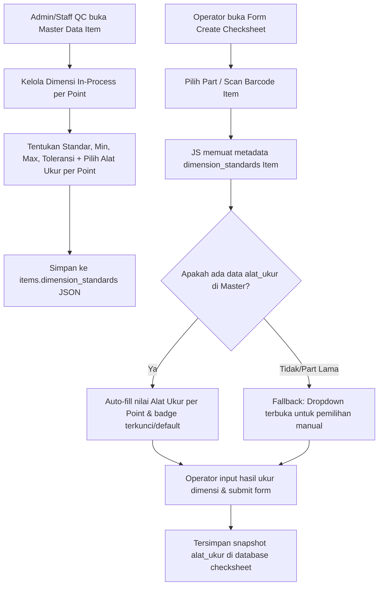

# PRD: Integrasi Konfigurasi Alat Ukur Otomatis Berbasis Master Data Part

**Dokumen Versi**: 1.1 (Production Release)  
**Tanggal**: 15 - 16 Oktober 2026  
**Status**: Selesai / Implemented (Production Ready)  
**Modul Terdampak**: 
- Master Item (`items`)
- In-Process Checksheet (`in_process_checksheets`)
- First Piece Approval (`first_piece_approvals`)
- General Settings (`measuring_tools`)

---

## 1. Latar Belakang & Masalah

Pada implementasi sebelumnya, penentuan jenis **Alat Ukur** (*CALIPER, THICKNESS GAUGE, FEELER GAUGE, PUSH-PULL, dll.*) dilakukan secara manual oleh operator di form input Create/Edit checksheet (In-Process dan First Piece Approval).

### Kendala Metode Lama:
1. **Beban Input Operator**: Operator harus memilih alat ukur secara manual per-point dimensi pada setiap pembuatan checksheet baru.
2. **Risiko Human Error**: Kemungkinan salah memilih jenis alat ukur yang tidak sesuai dengan instruksi kerja / drawing QC master part.
3. **Data Redundan**: Suatu part yang sama selalu diukur dengan alat yang sama pada setiap point-nya, sehingga konfigurasi ini idealnya menjadi properti baku dari **Master Data Part (Item)**, bukan ditentukan ulang berulang kali saat transaksi checksheet.

---

## 2. Tujuan & Manfaat

1. **Otomatisasi Input**: Saat operator memilih Part/Item pada form checksheet, seluruh data alat ukur per-point langsung terisi otomatis (*auto-filled*).
2. **Single Source of Truth**: Konfigurasi alat ukur dikelola terpusat di Master Data Part oleh Engineer / Staff QC yang berwenang.
3. **Standarisasi QC**: Memastikan kesesuaian alat ukur di lapangan dengan standar inspeksi part yang telah disetujui.
4. **Efisiensi Waktu Pengisian**: Mempercepat cycle time input data checksheet bagi operator di lini produksi.

---

## 3. Alur Kerja Baru (Workflow)



---

## 4. Spesifikasi Kebutuhan Fungsional (Functional Requirements)

### 4.1. Modul Master Item
1. **Antarmuka Tambah & Edit Item**:
   - Menambahkan kolom **"Alat Ukur"** pada tabel "Standar Dimensi In-Process" (`#modal-dimension-table` dan `#edit-modal-dimension-table`).
   - Kolom berupa dropdown `<select>` yang opsinya diambil secara dinamis dari master `GeneralSetting::getMeasuringTools()`.
2. **Penyimpanan Data (`ItemService`)**:
   - Menangkap input `dimension_alat_ukur[]` saat submit form tambah/edit item.
   - Menyimpan ke dalam struktur array JSON `items.dimension_standards`:
     ```json
     [
       {
         "point": "1",
         "size": "10.50",
         "min": "10.40",
         "max": "10.60",
         "tolerance": "0.10",
         "alat_ukur": "CALIPER"
       },
       {
         "point": "2",
         "size": "2.00",
         "min": "1.95",
         "max": "2.05",
         "tolerance": "0.05",
         "alat_ukur": "THICKNESS GAUGE"
       }
     ]
     ```

### 4.2. Form Create In-Process & First Piece Approval (FPA)
1. **Auto-Fill Otomatis**:
   - Saat item dipilih pada dropdown `#item_id`, skrip frontend membaca `dimension_standards` yang tersimpan pada atribut `data-dimension-standards` item terpilih.
   - Mengisi otomatis nilai dropdown/label alat ukur untuk setiap Point 1, Point 2, dst.
2. **Visual & User Experience**:
   - Jika alat ukur telah terkonfigurasi di master item, dropdown alat ukur pada form create akan terisi otomatis dengan penanda visual (misal: badge / border hijau lembut atau label *"Dari Master Part"*).
   - Operator tidak perlu lagi mengeklik dropdown manual untuk tiap point.
3. **Mekanisme Fallback**:
   - Jika part belum memiliki konfigurasi alat ukur di master data (misal data lama), dropdown tetap dapat dipilih secara manual oleh operator sebelum data disimpan agar tidak memblokir operasional produksi.
4. **Validasi Submisi**:
   - Tetap memvalidasi bahwa setiap point dimensi yang diisi wajib memiliki alat ukur yang terdefinisi (baik dari master maupun input manual).

### 4.3. Form Edit & Tampilan Index Checksheet
1. **Konsistensi Data**:
   - Data `alat_ukur` yang tersimpan pada checksheet berfungsi sebagai *historical snapshot* (tetap valid meskipun kelak master item diubah).
   - Di modal edit checksheet, data alat ukur yang telah tersimpan dimuat kembali dengan akurat.
2. **Tabel Index & Detail Popup**:
   - Menampilkan badge alat ukur di index table serta popup modal `#modalDetailAlatUkur` tetap berjalan sesuai fitur yang sudah dirancang sebelumnya.

---

## 5. Rencana Perubahan Kode (Technical Changes)

| No | File Path | Komponen | Deskripsi Rencana Perubahan |
|---|---|---|---|
| 1 | `app/Services/ItemService.php` | Backend Service | Menambahkan penangkapan `$data['dimension_alat_ukur']` di `processDimensionStandards()` agar tersimpan ke JSON `dimension_standards`. |
| 2 | `app/Http/Controllers/ItemController.php` | Controller | Mem-passing data `$measuringTools = GeneralSetting::getMeasuringTools()` ke view `items.index`. |
| 3 | `resources/views/items/index.blade.php` | Blade View | Menambahkan header kolom `<th>Alat Ukur</th>` dan `<select name="dimension_alat_ukur[]">` pada tabel dimensi modal tambah & edit item. |
| 4 | `public/js/items/items-form-logic.js` | Frontend JS | Mengupdate fungsi `dimensionRowTemplate()` dan iterasi `item.dimension_standards` di modal edit agar merender dropdown alat ukur yang sesuai. |
| 5 | `app/Services/InProcessChecksheetService.php` | Backend Service | Mengupdate `getConsolidatedStandards()` agar menyertakan field `alat_ukur`, serta melengkapi method penyimpanan `alat_ukur` di `createChecksheet` dan `updateChecksheet`. |
| 6 | `app/Models/InProcessChecksheet.php` | Eloquent Model | Menambahkan `alat_ukur` ke `$fillable`, serta accessor `getAlatUkurArrayAttribute()` dan `getAlatUkurFormattedAttribute()`. |
| 7 | `public/js/checksheet/in-process.js` | Frontend JS | Mengupdate event change item agar secara otomatis melakukan autofill ke `.point-alat-ukur-select` berdasarkan data `alat_ukur` dari master item. |
| 8 | `public/js/checksheet/fpa.js` | Frontend JS | Menambahkan logika auto-fill alat ukur yang sama pada form create FPA saat memilih part. |

---

## 6. Struktur Data (Sebelum vs Sesudah)

### Sebelum (Hanya Standar Dimensi):
```json
[
  {
    "point": "1",
    "size": "15.00",
    "min": "14.90",
    "max": "15.10",
    "tolerance": "0.10"
  }
]
```

### Sesudah (Terintegrasi Alat Ukur):
```json
[
  {
    "point": "1",
    "size": "15.00",
    "min": "14.90",
    "max": "15.10",
    "tolerance": "0.10",
    "alat_ukur": "CALIPER"
  }
]
```

*Catatan Kepatuhan Arsitektur:*
- Backward compatible: Jika key `alat_ukur` belum ada pada part lama, sistem memberikan fallback `null` tanpa error.
- Tidak membutuhkan migrasi skema tabel baru untuk `items` karena kolom `dimension_standards` sudah bertipe `JSON`.

---

## 7. Rencana Pengujian (QA Plan)

1. **Uji Master Item**:
   - Buka menu Master Item -> Tambah/Edit Item.
   - Tambah baris dimensi: Point 1 (Caliper), Point 2 (Thickness Gauge).
   - Simpan data dan buka kembali modal edit untuk memastikan pilihan alat ukur terpilih dengan benar.
2. **Uji Auto-Fill Form Create In-Process**:
   - Buka form Tambah In-Process Checksheet.
   - Pilih item yang baru disetting alat ukurnya.
   - Pastikan dropdown alat ukur pada kolom Point 1 dan Point 2 langsung terisi otomatis sesuai master data.
3. **Uji Auto-Fill Form Create FPA**:
   - Buka form Tambah FPA.
   - Pilih item terkait, pastikan auto-fill berjalan serupa.
4. **Uji Simpan & Transaksi**:
   - Submit checksheet dan pastikan data tersimpan di database (`in_process_checksheets.alat_ukur`).
   - Periksa tampilan di index tabel dan modal popup `#modalDetailAlatUkur`.

---

## 8. Hasil Implementasi & Penyempurnaan Tambahan (16 Oktober 2026)

Seluruh fitur telah berhasil diimplementasikan dan diverifikasi dengan penyempurnaan berikut:
1. **Cascading Downwards Dropdown**: Mengubah alat ukur di point atas otomatis mengalir ke point-point di bawahnya pada modal master item (`items-form-logic.js`).
2. **Pewarisan Baris Baru**: Baris dimensi baru otomatis mewarisi alat ukur dari baris terakhir.
3. **Fleksibilitas Tombol Cavity & Point**: Tombol manual **+ Cavity**, **- Cavity**, **+ Point**, dan **- Point** pada form In-Process & FPA tetap aktif dan terlihat meskipun kolom dimensi otomatis ditarik dari master data.
4. **Dynamic Fallback Data Lama**: Data checksheet lama yang dibuat sebelum fitur ini ada secara otomatis menampilkan alat ukur di halaman index berkat accessor model `InProcessChecksheet` dan `FirstPieceApproval` tanpa memicu query tambahan ke database (0 N+1).
5. **Kepatuhan Arsitektur UI**: Seluruh JavaScript interaktif diekstrak ke berkas eksternal (`fpa.js` dan `in-process-index.js`), mematuhi aturan baku arsitektur [`docs/RULE.md`](file:///D:/laragon/www/qc-project/docs/RULE.md).
