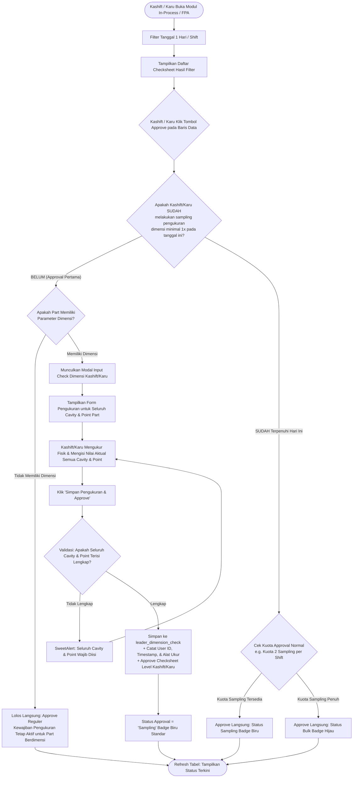

# PRD & Alur Proses: Fitur Mandatory Sampling Pengukuran Dimensi Kashift & Karu (In-Process & FPA)

---

## 1. Dokumen Kontrol & Ringkasan Eksekutif

| Parameter | Keterangan |
| :--- | :--- |
| **Nama Dokumen** | PRD - Mandatory Daily Sampling Dimension Check by Kashift/Karu |
| **Modul Terkait** | 1. In-Process Checksheet (`in_process`)<br>2. First Piece Approval (`first_piece_approval`) |
| **Target Role** | 1. **Kashift QC** (Plant Karawang)<br>2. **Kepala Regu / Karu QC** (Plant Jakarta) |
| **Frekuensi Wajib** | Minimal **1x sehari** per leader (Kashift/Karu) |
| **Cakupan Pengukuran** | **Wajib mengukur seluruh cavity dan seluruh point** yang aktif pada part tersebut |
| **Trigger Utama** | Approval Pertama / Sampling Pertama pada tanggal inspeksi yang difilter |
| **Penanda Visual** | Status Approval tetap menggunakan **Badge Biru `Sampling`** standar yang sudah ada. Perbedaan terletak pada **kolom Check Dimensi** yang menyajikan data Inspector (atas) dan data Kashift/Karu (bawah). |
| **Status Dokumen** | **Disetujui (Approved by User)** |

---

## 2. Latar Belakang & Tujuan Bisnis

### A. Masalah Saat Ini
Proses persetujuan (*approval*) checksheet In-Process dan FPA oleh tingkatan pimpinan shift (Kashift di Karawang dan Kepala Regu di Jakarta) masih berfokus pada verifikasi administratif di sistem. Belum ada mekanisme sistematis yang memastikan pimpinan shift terjun langsung melakukan pengukuran fisik pembanding untuk memvalidasi data Inspector di lini produksi.

### B. Tujuan Fitur
1. **Verifikasi Fisik Mandatory**: Mewajibkan Kashift/Karu melakukan pengukuran mandiri minimal 1x per hari kerja pada seluruh cavity dan point spesifikasi part yang dipilih.
2. **Standardisasi Mutu Antar-Plant**: Menyelaraskan alur verifikasi antara Plant Karawang (Kashift) dan Plant Jakarta (Karu).
3. **Penyajian Data Komparatif Bersih**: Menampilkan hasil ukur Inspector dan hasil ukur Kashift/Karu secara berdampingan vertikal dalam kolom Check Dimensi tanpa elemen dekoratif berlebih/tanpa icon.

---

## 3. User Persona & Hak Akses

| Role | Plant | Tanggung Jawab dalam Fitur Ini |
| :--- | :--- | :--- |
| **Inspector QC** | Karawang & Jakarta | Melakukan inspeksi awal, mencatat dimensi seluruh cavity/point, mengisi alat ukur yang digunakan. |
| **Kashift QC** | Karawang | Wajib melakukan sampling pengukuran mandiri (seluruh cavity & point) minimal 1x sehari saat melakukan approval checksheet pertama di hari tersebut. |
| **Kepala Regu / Karu QC** | Jakarta | Wajib melakukan sampling pengukuran mandiri (seluruh cavity & point) minimal 1x sehari saat melakukan approval checksheet pertama di hari tersebut. |
| **Supervisor / Manager** | Karawang & Jakarta | Memonitor status sampling leader melalui perbandingan hasil ukur di kolom Check Dimensi dan status badge sampling standar. |
| **Admin** | All Plant | Akses penuh untuk peninjauan, override, dan audit data log. |

---

## 4. Spesifikasi Kebutuhan & Aturan Bisnis (Business Rules)

### A. Mekanisme Pengecekan & Trigger Modal
1. **Filter Tanggal & Shift**:
   - Kashift/Karu menerapkan filter tanggal harian (1 hari kalender tertentu, baik per shift maupun 1 hari penuh).
2. **Pengecekan Kuota Harian (Daily Quota Evaluation)**:
   - Saat Kashift/Karu menekan tombol **Approve** pada suatu checksheet:
     - Sistem mengecek database: *Apakah user Kashift/Karu yang sedang login sudah pernah menginput data sampling pengukuran dimensi (`leader_dimension_check`) pada tanggal inspeksi tersebut untuk modul terkait?*
   - **Kondisi 1: BELUM PERNAH (Approval Pertama Hari Itu)**:
     - Aksi direct approval ditahan oleh sistem.
     - Sistem langsung memicu munculnya **Modal Input Check Dimensi Kashift/Karu**.
     - Kashift/Karu **wajib menginput hasil ukur untuk seluruh cavity dan seluruh point** yang terdaftar pada part tersebut.
     - Checksheet berstatus *Approved* setelah data pengukuran mandiri berhasil disimpan.
     - Record tersebut otomatis mendapatkan metode **Sampling (Badge Biru)** standar.
   - **Kondisi 2: SUDAH PERNAH (Minimal 1x Hari Itu Telah Terpenuhi)**:
     - Kewajiban harian dinyatakan telah terpenuhi.
     - Aksi approval pada checksheet berikutnya berjalan normal mengikuti aturan kuota approval reguler yang sudah ada (misal: kuota 2 sampling per shift di `ApprovalHelper.php`, selebihnya bulk).

### B. Penanganan Item Tanpa Dimensi (Non-Dimension Item)
- Jika data checksheet yang di-approve merupakan part yang **tidak memiliki parameter dimensi** (hanya pengecekan visual / `has_dimension == false`):
  - **Sistem memperbolehkan lolos langsung**: Checksheet dapat langsung di-approve secara reguler tanpa menampilkan modal pengukuran dimensi.
  - Kewajiban sampling pengukuran harian akan tetap aktif hingga Kashift/Karu meng-approve checksheet yang memiliki parameter dimensi pada hari itu.

### C. Aturan Badge Approval
- Format badge approval **tidak mengalami perubahan**: tetap menggunakan badge biru `Sampling` yang sudah berjalan saat ini. Tidak menggunakan teks tambahan khusus.
- Yang membedakan baris checksheet yang telah disampling pengukuran hanyalah isi tampilan pada **kolom Check Dimensi**.

---

## 5. Alur Proses (Flow Process)

### A. Diagram Alir Sistem (Flowchart)



### B. Tahapan Alur Detail
1. **Langkah 1 (Filter Data)**: User login sebagai Kashift (Karawang) atau Karu (Jakarta), membuka menu In-Process atau FPA, dan memfilter data tanggal 1 hari (bisa 1 shift atau 1 hari penuh).
2. **Langkah 2 (Klik Approve)**: User memilih baris checksheet pending dan menekan tombol *Approve*.
3. **Langkah 3 (Pengecekan Sistem)**:
   - Jika part tidak memiliki parameter dimensi: sistem langsung meloloskan approval tanpa memunculkan modal.
   - Jika part memiliki dimensi: sistem memeriksa apakah user sudah pernah melakukan sampling pengukuran dimensi di hari tersebut.
4. **Langkah 4 (Muncul Modal Pengukuran)**: Jika belum pernah (approval pertama), modal input dimensi muncul. Modal memuat seluruh cavity dan point spesifikasi part yang bersangkutan.
5. **Langkah 5 (Pengisian Pengukuran Lengkap)**: Kashift/Karu melakukan pengukuran fisik aktual dan mengisi seluruh kolom cavity & point pada modal.
6. **Langkah 6 (Penyimpanan & Approval)**: Sistem memvalidasi kelengkapan, menyimpan hasil ukur ke kolom database terpisah (`leader_dimension_check`), dan menyelesaikan proses approval checksheet dengan status sampling.
7. **Langkah 7 (Approval Berikutnya)**: Approval checksheet berikutnya pada hari yang sama berjalan langsung tanpa kewajiban mengisi modal lagi.

---

## 6. Spesifikasi Antarmuka Pengguna (UI/UX Specification)

### A. Desain Kolom "Check Dimensi" pada Tabel Utama
Mengacu pada aturan UI:
- **Tanpa Icon**: Tidak menggunakan icon pada keterangan teks (bersih dan to the point).
- **Tanpa Badge Ekstra di Kolom Dimensi**: Tidak menambahkan label/badge bertuliskan `[BADGE BIRU: SAMPLING PENGUKURAN KASHIFT/KARU]` di dalam kolom dimensi.
- **Badge Biru Standar**: Tetap berada di kolom Approval Status seperti sampling reguler.

#### Susunan Kolom Check Dimensi:
1. **Bagian Atas (Inspector)**:
   - Teks nama Inspector: `Inspector: [Nama User]` (posisi di atas keterangan alat ukur).
   - Keterangan alat ukur: `Alat Ukur: [Nama Alat Ukur]`.
   - Tabel dimensi hasil ukur Inspector.
2. **Garis Pemisah**:
   - Garis pemisah tipis/dashed (`border-top: 1px dashed #cbd5e1; margin: 4px 0;`).
3. **Bagian Bawah (Kashift / Karu)**:
   - Teks nama pimpinan shift: `Kashift QC: [Nama User] ([Waktu])` atau `Kepala Regu: [Nama User] ([Waktu])`.
   - Keterangan alat ukur pimpinan: `Alat Ukur: [Nama Alat Ukur Kashift/Karu]`.
   - Tabel dimensi hasil ukur Kashift/Karu (menampilkan seluruh cavity & point yang diukur).

#### Ilustrasi Tampilan Kolom Check Dimensi:
```text
┌────────────────────────────────────────────────────────────────────────┐
│ CHECK DIMENSI                                                          │
├────────────────────────────────────────────────────────────────────────┤
│ Inspector: Agus Santoso                                                │
│ Alat Ukur: Vernier Caliper Mitutoyo 150mm                              │
│                                                                        │
│ [Hasil Ukur Inspector]                                                 │
│ ┌─────────┬────────┬────────┬────────┬────────┐                        │
│ │ Point   │   P1   │   P2   │   P3   │   P4   │                        │
│ ├─────────┼────────┼────────┼────────┼────────┤                        │
│ │ Std     │  10.00 │  15.20 │   5.40 │  20.00 │                        │
│ │ Cav 1   │  10.02 │  15.21 │   5.39 │  20.01 │                        │
│ │ Cav 2   │  10.01 │  15.19 │   5.41 │  20.00 │                        │
│ └─────────┴────────┴────────┴────────┴────────┘                        │
│ ────────────────────────────────────────────────────────────────────── │
│ Kashift QC: Budi Pratama (10:42 WIB)                                   │
│ Alat Ukur: Digital Caliper Dial 0.01mm                                 │
│                                                                        │
│ [Hasil Ukur Kashift QC]                                                │
│ ┌─────────┬────────┬────────┬────────┬────────┐                        │
│ │ Point   │   P1   │   P2   │   P3   │   P4   │                        │
│ ├─────────┼────────┼────────┼────────┼────────┤                        │
│ │ Cav 1   │  10.01 │  15.20 │   5.40 │  20.02 │                        │
│ │ Cav 2   │  10.00 │  15.20 │   5.40 │  20.01 │                        │
│ └─────────┴────────┴────────┴────────┴────────┘                        │
└────────────────────────────────────────────────────────────────────────┘
```

### B. Desain Modal Input Sampling Dimensi Kashift/Karu
- **Container**: Menggunakan `.modal-xl` dengan `.modal-dialog-scrollable`, border radius `12px`, dan shadow lembut (standar Kakotora).
- **Header**:
  - Judul: `Input Sampling Pengukuran Dimensi (Kashift / Kepala Regu)`
  - Subtitle: Menampilkan tanggal, shift, nama part, part number, mesin, dan nama inspector pembuat.
- **Body**:
  - **Section Alat Ukur**: Dropdown / input pilihan alat ukur yang digunakan pimpinan.
  - **Section Tabel Input**: Menampilkan seluruh baris cavity dan kolom point part. Kolom input berupa numeric input dengan auto-highlighting (merah muda jika nilai di luar batas toleransi min/max standar part).
- **Footer**:
  - Tombol Batal (`btn-light border`)
  - Tombol Simpan & Approve (`btn-primary shadow-sm` dengan state loading spinner saat submit).

---

## 7. Desain Database & Arsitektur Teknis

### A. Skema Database (Migration)
Menambahkan kolom berikut pada tabel `in_process_checksheets` dan `first_piece_approvals`:

```php
Schema::table('in_process_checksheets', function (Blueprint $table) {
    $table->json('leader_dimension_check')->nullable()->after('dimension_check')
          ->comment('Hasil pengukuran sampling mandiri seluruh cavity/point oleh Kashift / Karu');
    $table->unsignedBigInteger('leader_dimension_user_id')->nullable()->after('leader_dimension_check')
          ->comment('ID user Kashift/Karu yang melakukan pengukuran');
    $table->timestamp('leader_dimension_at')->nullable()->after('leader_dimension_user_id')
          ->comment('Waktu dilakukannya sampling pengukuran');
    $table->string('leader_alat_ukur', 150)->nullable()->after('leader_dimension_at')
          ->comment('Alat ukur yang dipakai oleh Kashift/Karu');
});
```

### B. Format JSON Data Pengukuran (`leader_dimension_check`)
Menampung seluruh cavity dan point:
```json
{
  "cavity_1": {
    "1": "10.01",
    "2": "15.20",
    "3": "5.40",
    "4": "20.02"
  },
  "cavity_2": {
    "1": "10.00",
    "2": "15.20",
    "3": "5.40",
    "4": "20.01"
  }
}
```

### C. Kepatuhan Aturan Global (RULE.md & 7 Pilar Blueprint)
1. **Dilarang Menanam Skrip Inline di Blade**:
   - Seluruh logika modal, dynamic form cavity/point, dan validasi AJAX dibuat pada file JS eksternal:
     - `public/js/in_process/leader_sampling.js`
     - `public/js/first_piece_approval/leader_sampling.js`
   - File Blade hanya mendefinisikan modal markup dan obyek konfigurasi route: `window.inProcessSamplingConfig = { ... }`.
2. **Pemberantasan N+1 Query**:
   - Relasi user leader pengukur di-eager-load bersama checksheet: `$query->with(['item', 'user', 'leaderUser'])`.
3. **Database Indexing**:
   - Menggunakan B-Tree composite index untuk query filter kuota harian:
     `INDEX idx_leader_sampling (plant_id, date, leader_dimension_user_id)`.

---

## 8. Ringkasan Keputusan yang Disepakati (Review Summary)

Berdasarkan konfirmasi review:
1. **Cakupan Pengukuran**: Kashift/Karu **wajib mengukur seluruh cavity dan seluruh point** yang terdaftar pada part tersebut.
2. **Item Non-Dimensi**: Jika part tidak memiliki pengukuran (hanya visual / non-dimensi), approval **lolos langsung** tanpa modal.
3. **Badge Approval**: Menggunakan format **Badge Biru `Sampling` standar** seperti yang sudah berjalan sebelumnya, tanpa penambahan teks khusus.
4. **Desain Kolom Dimensi**: Teks bersih **tanpa icon** dan **tanpa penambahan badge ekstra** di dalam sel tabel.
